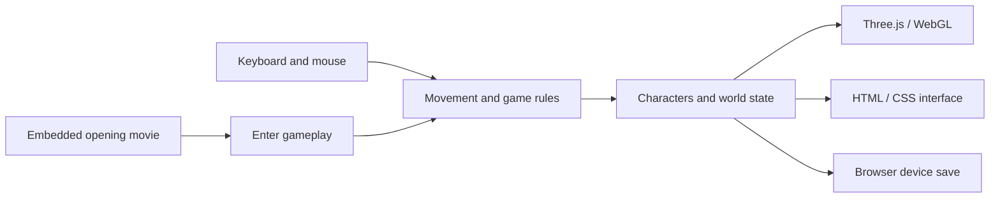

# HOW WE BUILT WINDBORNE

**Aether’s Trial: Windborne is a browser game built with JavaScript and Three.js.** Three.js draws the 3D world through WebGL, while HTML and CSS provide menus, subtitles, health bars and other interface elements. The browser uses the computer’s local graphics hardware to render the game. A cloud GPU is not required.

The project started with a 2D game. We preserved that version, then built a separate third-person 3D foundation in `src3d/`. The result is a compact fantasy action RPG prototype: explore, meet villagers, collect wind sigils and treasure, prepare for combat, and complete two trials.

## The tools we used

| Tool or language | Its job in this game |
|---|---|
| **JavaScript** | Movement, camera, enemies, damage, quests, saving and game states. |
| **Three.js** | 3D scenes, geometry, lights, materials, shadows, particles and rendering. |
| **WebGL 2** | The browser graphics interface used by the Three.js renderer. |
| **HTML and CSS** | Title screen, About screen, story journal, maps, health bars, buttons and subtitles. |
| **three-vrm** | Loading and animating the licensed humanoid base used for the traveler and villagers. |
| **Node.js and npm** | Running the build tools and automated tests during development. |
| **esbuild** | Combining and compressing the game code into the final HTML file. |
| **Python and FFmpeg** | Drawing the intro’s illustrated frames, mixing audio and encoding the opening movie. |

This is a code-driven project. We did not build its world in Unity or Unreal Engine.

## 1. We built the world from geometry

The ground begins as a large grid. A function called `heightAt(x, z)` gives each point a height, creating hills, an overlook, a lake basin and higher ground near the ruins. The same function helps keep the traveler, enemies and scenery aligned with the ground.

Houses, windmills, towers, tents, crates, trees and rocks are assembled from 3D shapes and custom meshes. Small canvas drawings provide roof tiles, masonry, leaves, grass and cloth patterns. This is **procedural art**: the program constructs it from authored rules and shapes.

The lake uses a custom shader—a small graphics program—to vary its color with depth, animate surface detail and show shallow edges and foam. Layered mountains, clouds, sunlight, fog and shadows help give the landscape depth.

Repeated scenery uses **instancing**, which lets many trees or grass clumps share geometry. Static pieces using the same material are also combined where possible. Distant grass and residents are hidden to reduce rendering work.

The world contains six discoverable landmarks, eight furnished enemy camps and working villagers. It is one bounded valley, rather than a streamed continent.

## 2. We created the traveler and the people

The detailed humanoid base is a licensed pixiv VRM sample. We load that model with `three-vrm`, then add custom blond hair, a braid, clothing, an embroidered cloak, a sword and a glider. The floating companion is assembled separately from authored shapes.

The base model has a skeleton. We rotate its bones to produce walking, running, attacks, jumps and gliding poses. The sword follows the hand during attacks and uses a separate position when carried. The cloak’s vertices move over time to suggest wind and motion.

Villagers reuse variants of the humanoid base with different clothes and simple actions. Some follow short routes; others fish, tend plants or work at a stall. These are authored routines, not a full simulated economy or daily-life AI.

The game does not bundle extracted Genshin character models, textures or voice recordings. Its character and location references are simplified fan-made interpretations. Asset provenance is recorded in `CREDITS.md`.

## 3. We connected input, movement and the camera

The main loop runs through the browser’s `requestAnimationFrame` function. Every frame it checks the current game state, updates the simulation, then renders the result.

Keyboard input becomes movement relative to the camera. Acceleration and turning are smoothed so the traveler does not snap instantly between directions. Jumping, gliding, stamina, dashing and attack cooldowns each have their own small set of rules.

Trees, houses and large props have simple collision boundaries. Movement is divided into smaller steps to reduce the chance of passing through them. The third-person camera follows the traveler, allows dragging and zooming, and makes basic adjustments near terrain and objects.



## 4. We gave enemies different decisions

Enemy definitions separate their appearance from their combat rules. The outdoor roster contains 24 enemies across six types: slimes, masked raiders, shield wardens, archers, mages and ruin sentinels.

Their behavior moves through states such as **idle → approach → warning → attack → recovery**. A warning gives the player time to respond. Archers aim before firing, mages mark dangerous ground, shield wardens resist frontal hits, and sentinels have slower heavy attacks.

The player has sword combos, a Pyro skill, a burst and a dash. Damage rules handle cooldowns, invulnerability, enemy health and elemental reactions. For example, a Pyro hit against a Hydro enemy causes Vaporize for 1.5× damage. Attack identifiers prevent the same hit from damaging an enemy repeatedly.

The two trials keep their own populations: ten regular enemies plus the first boss, then fifteen regular enemies plus the second boss. Clearing the first trial opens the second.

## 5. We added a reason to explore

The opening shows why Aether loses his memories: he fights the shrine’s guardian, then seals a broken wind shrine to save the village, and the seal consumes his memories. His companion finds him afterward and does not know his past. She leads him toward Windrise’s people, and Lyra asks him to recover three wind sigils. This is our original fan-made backstory. The two guardians connect the exploration loop to the valley’s damaged wind shrines.

The code tracks discovered places, activated waypoints, opened chests, collected sigils, defeated enemies, levels, health and trial completion. It writes this progress to the browser’s `localStorage`, so saving is local to that browser and device.

Trials capture the player’s progress when entered. Retry restores that snapshot, which avoids repeatedly collecting rewards from a failed attempt. The QA page uses a separate save key, so controlled tests do not overwrite the normal game’s save.

## 6. We made the opening as a movie

The opening is a pre-rendered MP4, rather than a live 3D cutscene. Python draws layered silhouette artwork with camera movement, wind, light and transitions. FFmpeg encodes those frames and mixes narration with the original synthesized score.

The short opening uses `tools/render-intro-short.py` and the local narration pipeline in `tools/render-voice-short.py`, retaining drawing helpers from `tools/render-intro.py`. Four scenes fit into 30 seconds: the shrine erupts (0–6), Aether duels the guardian with a sword parry, dash and slash (6–16), he seals the breach and his memories scatter (16–23), and he wakes beside his companion (23–30). Kokoro’s `af_heart` female voice is generated locally; music drops under the speech. The voice remains synthetic. The earlier 64-second renderer is retained in `tools/render-intro-extended.py`. Verification results for the short revision are tracked in `ENGINEERING_REPORT.md`; earlier decode and test results do not establish its playback.

A more natural delivery comes from both the voice and the writing: shorter phrases, conversational storytelling, pauses between thoughts, and music kept below speech. The voice remains synthetic; it is not a recording of a human actor.

Inside the game, `intro-player.js` controls the video. Subtitles follow the movie’s playback time, so pausing the video also pauses the story. Skip and natural completion stop playback before gameplay begins. Continue and Retry bypass the opening. The title screen’s Watch opening action previews it without changing the saved journey.

## 7. We packaged the game into one file

`build-3d.cjs` uses esbuild to combine the JavaScript modules, then inserts the interface and styles. It embeds the avatar, opening movie and fallback narration as data inside `index.html`.

That means the player does not need to download models, use a speech service or contact a CDN while playing. Development dependencies and optional voice-model downloads are separate from the finished game. Direct `file://` opening has not been verified by the automated browser; our browser checks use a local server.

## The files to edit

| Change you want | Main source files |
|---|---|
| Terrain, lake, trees and grass | `src3d/world.js`, `src3d/landscape.js`, `src3d/core.js` |
| Houses, landmarks and camps | `src3d/buildings.js`, `src3d/landmarks.js`, `src3d/camp-art.js` |
| Traveler, outfit and companion | `src3d/avatar.js`, `src3d/costume.js`, `src3d/companion.js` |
| Movement, camera and game-state flow | `src3d/main.js` |
| Enemy numbers, stats and positions | `src3d/enemy-config.js` |
| Enemy models and combat | `src3d/enemy-models.js`, `src3d/battle.js`, `src3d/effects.js` |
| Villagers and their routines | `src3d/residents.js`, `src3d/resident-avatars.js` |
| Story and game description | `src3d/story.js`, `src3d/game-info.js` |
| Menus and visual interface | `src3d/ui.html`, `src3d/style.css` |
| Opening playback and subtitles | `src3d/intro-player.js` |
| Final HTML packaging | `build-3d.cjs` |

Edit the source files, then rebuild. Changes made directly to generated `index.html` will be replaced by the next build.

## How to run the development workflow

With Node.js and npm installed, open a terminal in the project:

```bash
cd Aether-s-trial-thai-
npm ci
npm run build
npm test
npm run build:qa
```

`npm ci` installs the versions pinned in the lockfile. `npm run build` creates the playable `index.html`. `npm test` runs core simulation, combat and intro-controller checks. `npm run build:qa` creates a separate `qa.html` with browser regression controls.

To serve the files locally:

```bash
python3 -m http.server 8765
```

Open `http://127.0.0.1:8765/` for the game, or `/qa.html` for its test page. If port 8765 is already serving this project, use that existing server instead of starting another one.

The original 2D project remains available separately:

```bash
npm run test:legacy
npm run build:legacy
```

Those commands test the retained 2D code and build `legacy-2d.html`; they do not replace the 3D game.

## How we checked it

Automated tests cover damage, reactions, enemy attack timing, shield counters, rewards, saving, collision and video-player behavior. Browser checks exercise actual loading, interface navigation, movement, pause, combat progression and completion screens. Screenshots and video frames are inspected for visual problems, and the opening is checked for decoding and playback.

The trial regression fixtures restore player health and position the player near targets. They verify the combat implementation and progression, but do not prove that both trials have been completed manually or that the difficulty is balanced. Current evidence is recorded in `ENGINEERING_REPORT.md` and `tests/verification-3d.json`.

## What would make it closer to a finished game?

The next major improvements are professionally authored character models, a broader animation library, better camera obstruction handling, richer quests, more detailed settlement layouts and dedicated performance work on target devices. Human voice acting would provide more precise emotional direction than synthetic narration.

This prototype has useful foundations, but it does not reproduce Genshin’s world scale, asset quality or every mechanic. More GPU power alone would not create those assets or systems; most of that work is art, animation, design and engineering.

## A one-minute explanation you can present

“We built Aether’s Trial: Windborne as a single-player fantasy game that runs in a browser. JavaScript controls the gameplay, while Three.js uses WebGL to draw the 3D world. We generated the terrain, houses, trees and camps through code, and adapted a licensed humanoid model for the traveler and villagers.

“We added a third-person camera, movement, sword combos, elemental attacks and enemies with different warning and attack patterns. Exploration connects to Lyra’s wind-sigil quest and two boss trials. Progress is saved on the player’s device.

“The opening movie is made locally from animated silhouette artwork, narration and music. Finally, esbuild combines the game and its assets into one HTML file. We check the rules with automated tests and review the actual game in a browser. It is a playable prototype built to grow through better art, animation and more content.”

## Movement and combat update

Character movement uses smooth acceleration and braking, continuous stride timing, blended rig poses, turn lean and softer landings. Jump input has a 120 ms buffer and 100 ms edge grace period. Enemies have increased health and damage, faster pursuit and shorter cooldowns while keeping their visible attack warnings. The Mitachurl has 700 HP and the Storm Drake 1,200 HP; both enrage below half health.
